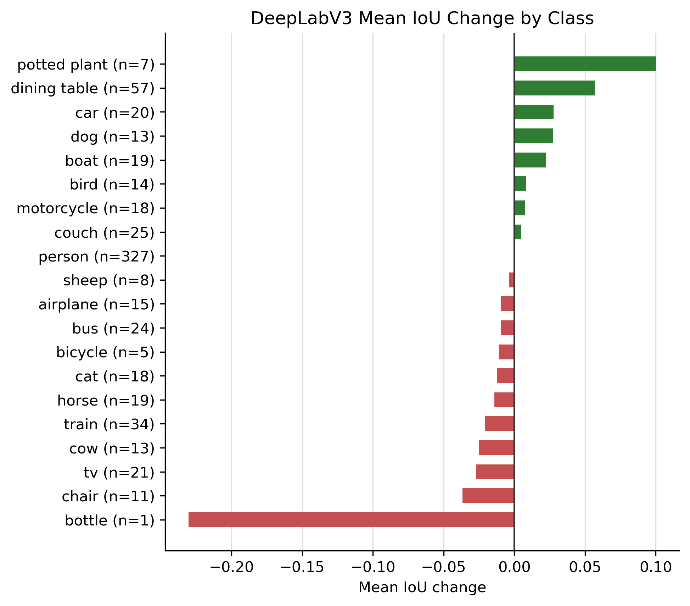

# Comparative Analysis of SAM, MobileSAM, FastSAM, and DeepLabV3 Fine-Tuning on COCO 2017

**Author:** Rutvikkumar Babubhai Balar  
**Institution:** Deggendorf Institute of Technology (M.Sc. Applied Computer Science — Computer Vision, Summer Semester 2026)  
**Hardware Environment:** Python, PyTorch, Torchvision, CUDA (NVIDIA GeForce RTX 2080 SUPER)

---

## Overview

This project conducts an end-to-end experimental comparison between **promptable foundation segmentation models** (**SAM ViT-B**, **SAM ViT-H**, **MobileSAM**, and **FastSAM**) and a **closed-vocabulary semantic segmentation architecture** (**DeepLabV3-ResNet50**) on the **COCO 2017** benchmark, followed by **staged fine-tuning of DeepLabV3-ResNet50 across 50,000 COCO training images** on the 20 PASCAL-VOC-mapped categories.

### Key Research Questions
1. **Promptable vs. Lightweight Foundation Models:** How much segmentation quality is retained when replacing heavy ViT backbones (**SAM ViT-H**, 636M parameters) with distilled or CNN-based alternatives (**MobileSAM** TinyViT, **FastSAM** YOLOv8-seg) under identical COCO bounding-box prompts?
2. **Closed-Vocabulary Semantic Baseline vs. Instance-Aware Prompting:** Why do unprompted semantic segmentation networks underperform box-prompted models on multi-instance scenes, and which object categories benefit from large-scale domain adaptation versus failing due to instance merging?

---

## Repository Structure

```text
├── Project_SAM_MobileSAM_FastSAM_DeepLabV3_COCO.ipynb   # Main unified evaluation & visualization notebook
├── tools/
│   └── run_deeplabv3_trials_external.py                 # Standalone CUDA staged fine-tuning & trial runner (A-E)
├── assets/
│   └── report_deeplab_classwise_before_after.png        # Per-class IoU delta chart across 20 VOC categories
├── docs/
│   ├── Balar_Rutvikkumar_Computer_Vision_Report.pdf     # Full 8-page IEEE-format technical report
│   └── computer_vision.tex                              # LaTeX source of the technical report
└── requirements.txt                                     # Python dependencies
```

---

## Experimental Setup & Evaluation Protocol

- **Evaluation Subsets:**
  - **Primary Benchmark (`val_1000`):** 1,000 valid ground-truth instance masks across 136 COCO validation images (`669` instances belong to the 20 VOC-compatible classes).
  - **Extended Robustness Check (`val_5000`):** 4,844 valid ground-truth instance masks across 675 COCO validation images (`3,116` instances in the 20 VOC-compatible classes).
- **Prompting Protocol:** Ground-truth COCO bounding boxes `[x, y, w, h]` converted to `[x1, y1, x2, y2]` are supplied to **SAM ViT-B**, **SAM ViT-H**, **MobileSAM**, and **FastSAM**.
- **DeepLabV3 Protocol:** Evaluates unprompted whole-image semantic predictions restricted to the 20 VOC-mapped COCO categories (`airplane`, `bicycle`, `bird`, `boat`, `bottle`, `bus`, `car`, `cat`, `chair`, `cow`, `dining table`, `dog`, `horse`, `motorcycle`, `person`, `potted plant`, `sheep`, `sofa`, `train`, `tv`), scoring class-matched foreground masks within each instance's ground-truth crop region.

---

## Quantitative Benchmark Results

### 1. Primary 1,000-Object Benchmark (`val_1000`)

| Model | Evaluated Objects | Mean IoU | Median IoU | Mean Dice | Success (`IoU >= 0.5`) | High Quality (`IoU >= 0.75`) | Runtime (`s/img`) |
| :--- | :---: | :---: | :---: | :---: | :---: | :---: | :---: |
| **SAM ViT-H** | 1,000 | **0.8215** | **0.8707** | **0.8920** | 93.70% | **78.00%** | 13.07 |
| **MobileSAM** | 1,000 | 0.8161 | 0.8617 | 0.8898 | **94.80%** | 76.20% | **0.54** |
| **SAM ViT-B** | 1,000 | 0.7762 | 0.8364 | 0.8588 | 88.90% | 69.50% | 5.13 |
| **FastSAM** | 1,000 | 0.6029 | 0.7495 | 0.6929 | 71.00% | 49.90% | **0.23** |
| **DeepLabV3 (Pretrained)** | 669 *(VOC subset)* | 0.6253 | 0.7130 | 0.7192 | 69.36% | 45.44% | 0.44 |
| **DeepLabV3 (Fine-Tuned)** | 669 *(VOC subset)* | **0.6288** | **0.7170** | **0.7224** | **70.10%** | **46.19%** | 0.43 |

> **Key Finding:** **MobileSAM** preserves **99.3% of SAM ViT-H's Mean IoU** (`0.8161` vs. `0.8215`) and achieves the highest `IoU >= 0.5` success rate (`94.80%`) while running **24.2x faster** (`0.54 s/img` vs. `13.07 s/img`).

### 2. Extended 4,844-Object Robustness Benchmark (`val_5000`)

| Model | Evaluated Objects | Mean IoU | Median IoU | Mean Dice | Success (`IoU >= 0.5`) | High Quality (`IoU >= 0.75`) |
| :--- | :---: | :---: | :---: | :---: | :---: | :---: |
| **MobileSAM** | 4,844 | **0.8234** | **0.8691** | **0.8950** | **94.88%** | **77.79%** |
| **FastSAM** | 4,844 | 0.6194 | 0.7689 | 0.7082 | 73.12% | 53.03% |
| **DeepLabV3 (Pretrained)** | 3,116 *(VOC subset)* | 0.6203 | 0.7069 | 0.7145 | 68.93% | 44.32% |
| **DeepLabV3 (Fine-Tuned)** | 3,116 *(VOC subset)* | **0.6213** | 0.7059 | **0.7155** | **69.10%** | **44.45%** |

---

## DeepLabV3-ResNet50 Fine-Tuning & Per-Class Failure Analysis

### Staged Fine-Tuning Pipeline (`50,000` COCO Training Images)
To adapt pretrained `DeepLabV3_ResNet50_Weights.DEFAULT` to dense multi-object COCO pseudo-semantic masks (`520x520` resolution, 21 channels: background + 20 VOC classes):
1. **Staged Unfreezing:** Warmup head-only training (`classifier` + `aux_classifier`) followed by selective unfreezing of `backbone.layer4` + heads (**`33.4M / 42.0M` trainable parameters**) with **all BatchNorm layers frozen in `eval()` mode** to prevent small-batch running-stat drift (`batch_size=4`, `grad_accum_steps=2`, effective batch size `8`).
2. **Composite Loss Function:** Class-weighted Cross-Entropy (`w_bg = 0.15` to counter background pixel dominance) combined with `0.5x` multi-class foreground Dice loss (`total_loss = ce_loss + 0.5 * dice_loss`).
3. **Checkpoint Weight Interpolation (`alpha = 0.5`):** Linear state-dict blending between the pretrained baseline and the 50k fine-tuned checkpoint (`Trial E_blend50`) mitigated catastrophic forgetting on sparse classes while retaining domain-adapted boundaries.

### Per-Class IoU Improvement vs. Failure Modes



Rather than uniform movement across categories, fine-tuning produced **strong class-specific gains on structured foreground objects** alongside **diagnostic regressions on cluttered/occluded multi-instance categories**:

| Category Group | Specific Per-Class IoU Deltas (`val_1000`, 669 VOC Instances) | Technical Root Cause / Diagnosis |
| :--- | :--- | :--- |
| **Top Improved Structured Classes** | **`potted plant` (+0.100 IoU)**, **`dining table` (+0.057)**, **`car` (+0.028)**, **`dog` (+0.028)**, **`boat` (+0.023)**, **`train` (+0.022)**, **`horse` (+0.015)**, **`bus` (+0.012)** | Reduced background weight (`w_bg = 0.15`) + foreground Dice loss sharpened object boundaries on medium/large structured objects that were under-segmented by the PASCAL-VOC-pretrained head. |
| **Unchanged / Stable Core Classes** | **`person` (+0.002 IoU across 301 instances)**, **`cat` (+0.010)**, **`bicycle` (+0.009)** | High sample density in COCO preserved stable representations under frozen BatchNorm and `alpha = 0.5` weight interpolation. |
| **Degraded Cluttered / Small Classes** | **`chair` (-0.036 IoU)**, **`tv` (-0.028)**, **`cow` (-0.025)**, **`sofa` (-0.017)**, **`bottle` (-0.231, n=7)** | **Fundamental Semantic vs. Instance Bottleneck:** Unprompted DeepLabV3 outputs a single class probability map per image, merging adjacent or overlapping instances of the same class (e.g., rows of chairs or clustered bottles) into one connected region and failing without spatial box prompts. |

---

## Reproducing the Experiments

```bash
# 1. Install dependencies
pip install -r requirements.txt

# 2. Run external DeepLabV3 staged fine-tuning trials (CUDA recommended)
python tools/run_deeplabv3_trials_external.py --device cuda

# 3. Launch the unified evaluation & visualization notebook
jupyter notebook Project_SAM_MobileSAM_FastSAM_DeepLabV3_COCO.ipynb
```
